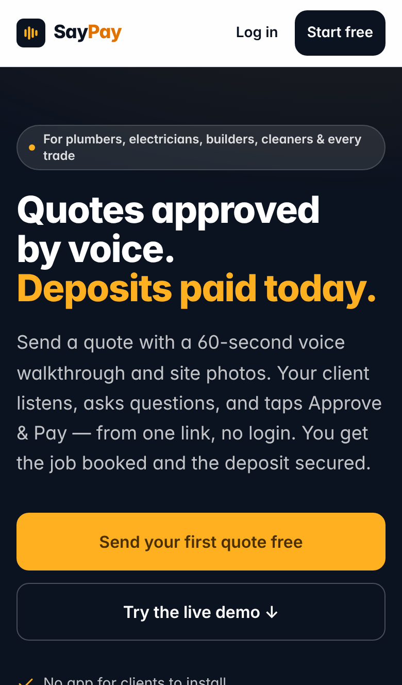
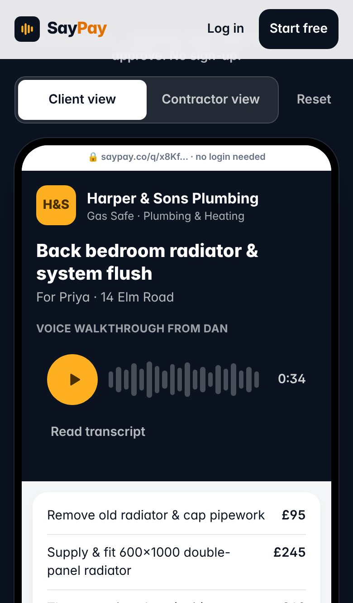
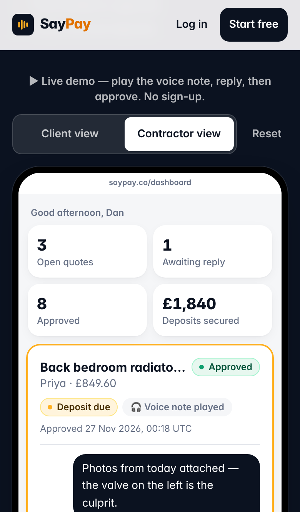
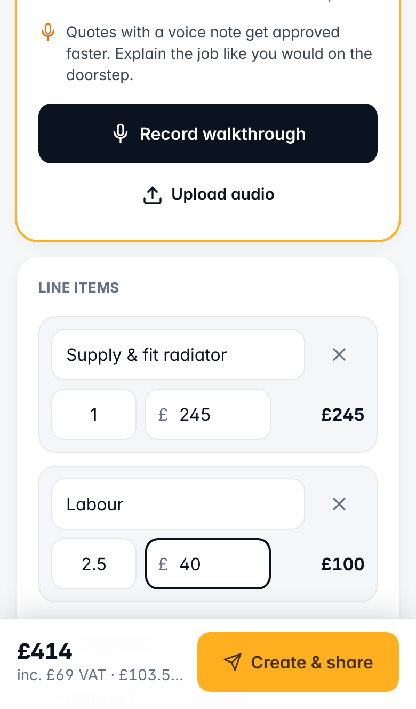
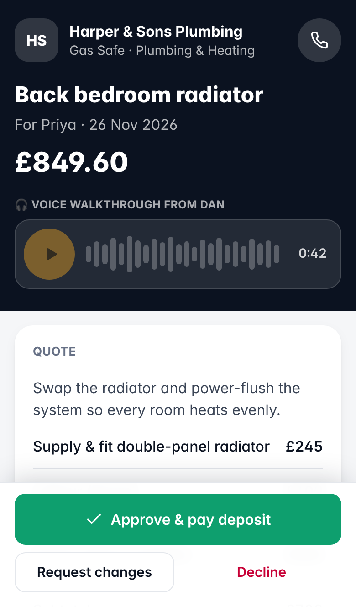
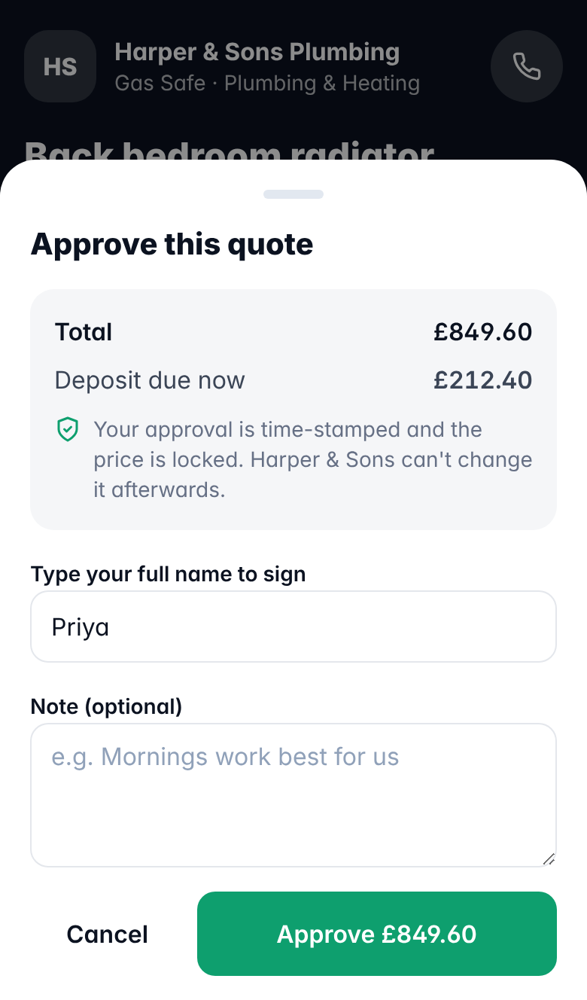

# SayPay — Quotes with a voice note, for trades

**saypay.co** · Quote-to-cash for tradespeople, contractors and service businesses.

Contractors build a quote in about 60 seconds, record a voice-note walkthrough, attach site photos/video, and share one magic link over WhatsApp or SMS. The client opens it on their phone with no account, listens, asks questions (text, voice or photos), then taps **Approve & pay deposit**, **Request changes** or **Decline**. Approval locks the terms with a timestamped audit record, and the deposit is collected through Stripe.

## Screenshots

| Landing page | Live demo (client) | Live demo (contractor) |
| --- | --- | --- |
|  |  |  |
| **Quote builder** | **Client magic link** | **Approve sheet** |
|  |  |  |

---

## Features

| Area | What's included |
| --- | --- |
| **Landing page** (`/`) | B2B marketing page with a **zero-signup live demo**: play a sample voice note (browser speech synthesis, so no audio asset ships), switch between client and contractor views, post a reply, and approve, request changes or decline. The contractor view updates live. |
| **Auth** | Supabase Auth with email + password **or** magic link. Cookie-based SSR sessions via `@supabase/ssr`, refreshed in `src/proxy.ts`. |
| **Dashboard** (`/dashboard`) | Stats (Open, Awaiting reply, Approved, Deposits secured), status filters, search, and one-tap **Copy link** / **Copy WhatsApp-SMS message** on every quote. |
| **Quote builder** (`/quotes/new`) | Title, client, itemised lines with live totals, quick-add chips, optional VAT/tax, deposit (None/25%/50%/custom %/fixed), expiry date, photo/video upload, and a **voice recorder** (`MediaRecorder`, live timer, 60s hard cap, review/redo, audio-file fallback). |
| **Quote detail** (`/quotes/[id]`) | Share panel (WhatsApp, SMS, copy), decision audit (who, when, IP, device), manual "deposit received", gallery, two-way thread with text, voice and media replies, edit & re-send, delete. |
| **Client magic link** (`/q/[token]`) | Branded header with logo, colour and tap-to-call. Voice walkthrough player, scope, line items, totals and deposit. Gallery plus **client photo/video uploader**, **client voice notes**, message thread, and a sticky one-thumb decision bar with bottom sheets. Approved quotes show a lock banner with timestamp. Polls for updates every 15s. |
| **Billing** | Stripe Checkout subscriptions, Customer Portal, and a raw-body verified webhook. Free tier of `FREE_QUOTE_LIMIT` quotes. |
| **Deposits** | Stripe Connect Express (destination charges straight to the contractor, optional platform fee), **or** the contractor's own payment link, **or** manual "mark received". |
| **PWA** | `public/manifest.json`, maskable icons and an apple-touch-icon, so the app can be added to the home screen on iOS and Android. |

## Tech stack

- **Next.js 16** (App Router, Server Components by default, Server Actions, Turbopack), **React 19**, **TypeScript** (`strict` + `noUncheckedIndexedAccess`)
- **Tailwind CSS v4** (design tokens in `src/app/globals.css`)
- **Supabase**: Postgres with RLS on every table, Auth, Storage (private bucket, signed URLs)
- **Stripe**: Checkout, Billing Portal, Connect, webhooks
- **zod** validates every Server Action and route input

---

## Project structure

```
saypay/
├── public/
│   ├── manifest.json                 # PWA manifest
│   └── icons/                        # 192/512/maskable PNG, apple-touch-icon, SVG
├── supabase/
│   ├── migrations/001_init.sql       # Schema, RLS, triggers, storage bucket + policies
│   ├── migrations/002_bank_transfer.sql # Bank details for bank-transfer payments
│   └── tests/rls.test.mjs            # Runs the migration in PGlite and asserts RLS (npm run test:db)
├── src/
│   ├── proxy.ts                      # Session refresh + route protection (Next 16 "proxy", ex-middleware)
│   ├── actions/                      # Server Actions ("use server")
│   │   ├── auth.ts                   #   sign in/up, magic link, sign out
│   │   ├── quotes.ts                 #   contractor: create/update/delete, uploads, thread, deposit
│   │   ├── client-quote.ts           #   magic-link: message, upload, decide, pay deposit (token-scoped)
│   │   ├── workspace.ts              #   business profile, logo
│   │   └── billing.ts                #   Stripe Checkout, Portal, Connect onboarding
│   ├── app/
│   │   ├── page.tsx                  # Landing + live demo
│   │   ├── login/                    # Auth UI
│   │   ├── auth/callback/route.ts    # Email link handler (PKCE code + token_hash)
│   │   ├── (app)/                    # Authenticated shell (top nav + mobile tab bar)
│   │   │   ├── dashboard/
│   │   │   ├── quotes/new/ · quotes/[id]/ · quotes/[id]/edit/
│   │   │   └── settings/
│   │   ├── q/[token]/                # Client magic link (no auth)
│   │   └── api/stripe/webhook/       # Raw-body verified webhook
│   ├── components/
│   │   ├── ui/                       # Button, Pill, Card, Field, Skeleton, icons
│   │   ├── media/                    # AudioPlayer, VoiceRecorder, MediaPicker, MediaGallery
│   │   ├── thread/                   # MessageThread, Composer (+ client/contractor bindings)
│   │   ├── quote/                    # QuoteBuilder, QuoteSummary, DecisionBar, ShareActions, …
│   │   └── demo/live-demo.tsx        # Landing-page interactive demo
│   └── lib/
│       ├── supabase/{server,client,admin,proxy}.ts
│       ├── database.types.ts · types.ts
│       ├── validation.ts             # zod schemas
│       ├── quote-math.ts (+ .test.ts) # single source of truth for totals
│       ├── storage.ts · upload-client.ts · media.ts
│       ├── tokens.ts                 # share_token = randomBytes(24).toString("base64url")
│       ├── stripe.ts · env.ts · share.ts · format.ts · quotes.ts · auth.ts
└── .env.example
```

---

## Setup

### 1. Install

```bash
npm install
```

```bash
cp .env.example .env.local
```

Requires Node 20.9+.

### 2. Supabase project

1. Create a project at [supabase.com](https://supabase.com).
2. Run the migration using **either** method:
   - **SQL editor**: paste the contents of `supabase/migrations/001_init.sql` and run it, then do the same with `002_bank_transfer.sql`.
   - **CLI**:
     ```bash
     npx supabase link --project-ref YOUR_REF
     ```
     ```bash
     npx supabase db push
     ```
3. From **Project Settings → API**, copy into `.env.local`:
   - `NEXT_PUBLIC_SUPABASE_URL`
   - `NEXT_PUBLIC_SUPABASE_ANON_KEY` (the anon or publishable key)
   - `SUPABASE_SERVICE_ROLE_KEY` (**server only**; never prefix it with `NEXT_PUBLIC_`)
4. **Authentication → URL Configuration**:
   - Site URL: your `NEXT_PUBLIC_SITE_URL` (e.g. `https://saypay.co`)
   - Redirect URLs: add `https://saypay.co/auth/callback` and `http://localhost:3000/auth/callback`
5. **Authentication → Providers → Email**: keep it enabled. Turning off "Confirm email" makes local testing faster; for production, leave it on and configure SMTP.

### 3. Storage bucket

The migration creates a **private** bucket called `quote-media` (50 MB per-file limit, `image/*`, `video/*` and `audio/*` only) plus the owner policies. To check it:

- **Storage → Buckets** should list `quote-media` with *Public* **off**.
- Object paths follow `{workspace_id}/{quote_id}/{contractor|client}-{uuid}.{ext}`, and logos use `{workspace_id}/branding/…`.
- On a paid Supabase plan you can raise the per-file limit (Storage settings and the bucket) and `MEDIA_LIMITS` in `src/lib/media.ts`.

How uploads work: the browser asks a Server Action for a **one-time signed upload URL** for a single path. It then uploads straight to Storage. The server checks that the object exists and reads its real size and MIME type before saving a row. Files are viewed through signed URLs that expire after one hour. Neither the service-role key nor public URLs ever reach the browser.

### 4. Stripe (optional for local development)

If `STRIPE_SECRET_KEY` is empty, billing is hidden and every workspace is unlimited.

1. **Product & price**: create a "SayPay Pro" product with a recurring price, and set `STRIPE_PRICE_ID`.
2. **Customer Portal**: Settings → Billing → Customer portal. Enable it and allow cancel and update payment method.
3. **Webhook**: Developers → Webhooks → Add endpoint
   - URL: `https://YOUR_DOMAIN/api/stripe/webhook`
   - Events: `checkout.session.completed`, `customer.subscription.updated`, `customer.subscription.deleted`
   - Copy the signing secret into `STRIPE_WEBHOOK_SECRET`.
4. **Local webhooks**:
   ```bash
   stripe listen --forward-to localhost:3000/api/stripe/webhook
   ```
   Use the `whsec_…` it prints as `STRIPE_WEBHOOK_SECRET`.
5. **Deposits via Connect** (optional): enable **Connect** in the Stripe dashboard with Express accounts. Contractors click **Settings → Connect Stripe**. Deposits are destination charges to their account, and you can set a platform fee with `STRIPE_DEPOSIT_FEE_BPS` (100 = 1%). The deposit is marked paid by the same `checkout.session.completed` webhook (`metadata.kind = "deposit"`).

### 5. Run it

```bash
npm run dev
```

Open http://localhost:3000, create an account, and send yourself a quote. Open the `/q/…` link in a private window or on your phone to see the client side.

---

## Environment variables

| Variable | Where | Purpose |
| --- | --- | --- |
| `NEXT_PUBLIC_SITE_URL` | public | Absolute URL for magic links, auth redirects and Stripe return URLs |
| `NEXT_PUBLIC_SUPABASE_URL` | public | Supabase project URL |
| `NEXT_PUBLIC_SUPABASE_ANON_KEY` | public | Anon/publishable key (RLS-restricted) |
| `SUPABASE_SERVICE_ROLE_KEY` | **server** | Magic-link actions, signed URLs, webhooks. Imported only through `server-only` modules |
| `SUPABASE_STORAGE_BUCKET` | server | Defaults to `quote-media` |
| `STRIPE_SECRET_KEY` | **server** | Enables billing and card deposits |
| `STRIPE_WEBHOOK_SECRET` | **server** | Verifies webhook signatures |
| `STRIPE_PRICE_ID` | server | Pro plan recurring price |
| `STRIPE_DEPOSIT_FEE_BPS` | server | Optional platform fee on deposits |
| `FREE_QUOTE_LIMIT` | server | Quotes allowed before upgrading (default 5) |

---

## Security model

- **RLS on every table.** Contractors (`authenticated`) only see rows in the workspace they own. `anon` has **no grants** on any table.
- **Column-level grants.** Contractors cannot write Stripe or billing columns, or decision and audit columns (`decided_at`, `decision_meta`, `approved_snapshot`, …). Those columns are written only by the server through the service role.
- **Database-enforced business rules** (trigger `quotes_guard`):
  - Approved quotes are **locked**: price, line items, scope and status can't change, even through the service role.
  - Declined quotes can't be reopened.
  - Contractors can't approve or decline their own quotes.
- **Client magic links are capabilities.** `share_token` is 192 bits from `crypto.randomBytes(24)`. Every `/q/[token]` action:
  1. checks the token format;
  2. validates input with zod;
  3. resolves the quote server-side;
  4. checks state;
  5. performs a narrow write.

  Approvals use a conditional update (`WHERE status IN (open…)`) so double-taps and races are harmless.
- `/q/*` responses send `X-Robots-Tag: noindex` and `Referrer-Policy: no-referrer`, so tokens don't leak to third parties.
- The Stripe webhook verifies the signature over the **raw body**. Handlers are idempotent, and a 500 makes Stripe retry.

### Tests

```bash
npm test
```

Runs the quote-math unit tests.

```bash
npm run test:db
```

Applies the migrations to an in-memory Postgres (PGlite) and runs 37 RLS, grant, constraint, trigger and storage-policy assertions.

```bash
npm run typecheck
```

---

## Deploying (Vercel)

1. Import the repo and add every variable from the table above under Production.
2. Set `NEXT_PUBLIC_SITE_URL` to the production domain, and add `/auth/callback` on that domain to Supabase redirect URLs.
3. Point the Stripe webhook at `https://YOUR_DOMAIN/api/stripe/webhook`.

## Handover / operations notes

- **Regenerate DB types** after schema changes:
  ```bash
  npx supabase gen types typescript --project-id <id> > src/lib/database.types.ts
  ```
- **Abandoned drafts.** Media uploaded in the builder before a quote is saved stays under `{workspace}/{draftId}/`. A scheduled job can delete folders with no matching `quotes.id` that are more than 24h old.
- **Rate limiting.** Magic-link actions are capability-protected but not rate-limited. For high-traffic deployments, put Vercel Firewall or Upstash rate limits in front of `/q/*` POSTs.
- **Real-time.** Client and contractor views refresh every 15–20s while visible. To push updates instead, add Supabase Realtime for contractors (RLS-scoped) or a broadcast channel per quote.
- **Notifications.** Email or SMS alerts to contractors on new replies and approvals are a natural next step: hook into `refresh()` in `src/actions/client-quote.ts`.
- **Branding.** Design tokens live in `src/app/globals.css` (`--color-hivis`, `--color-ink`, …).
